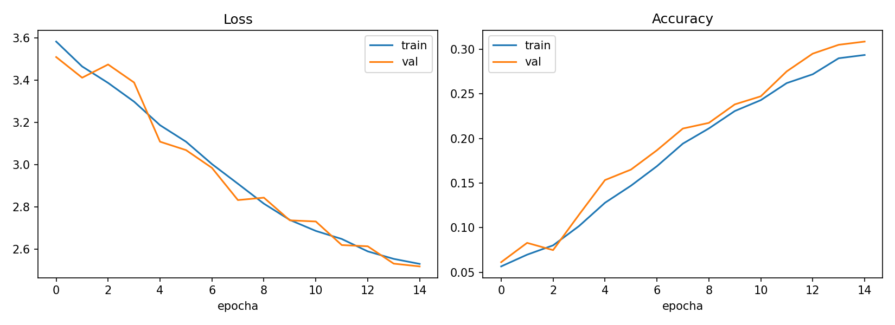
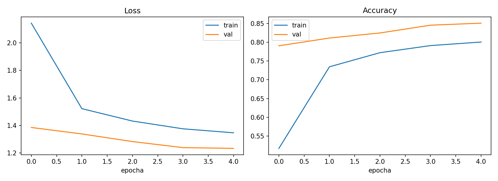
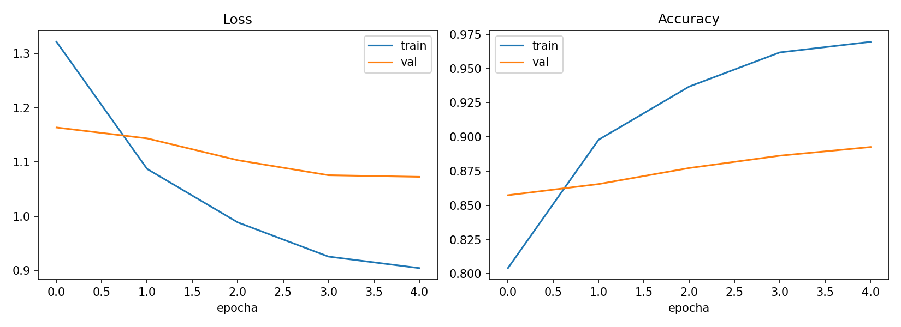

# Pet Breed Classification (Oxford-IIIT Pet, PyTorch)

Image classification of 37 cat and dog breeds. The project compares a small CNN trained from scratch with transfer learning from an ImageNet-pretrained ResNet18, and shows how much pretrained features help on a small dataset.

## Results

| Model | Input size | Epochs | Trainable params | Val acc | Test acc |
|-------|-----------|--------|------------------|---------|----------|
| Baseline CNN (from scratch) | 128×128 | 15 | 398k | 30.9 % | **32.7 %** |
| ResNet18, frozen backbone | 160×160 | 5 | 19k | 85.1 % | **83.2 %** |
| ResNet18, fine-tuned (all layers) | 160×160 | 5 | 11.2M | 89.3 % | **88.3 %** |

Random guessing would give about 2.7 % (37 classes). All experiments ran on a laptop CPU (roughly 21, 7 and 17 minutes of training respectively).





### Takeaways
- Training from scratch on ~5,000 images is not enough for 37 fine-grained classes. The baseline was still improving after 15 epochs, but it remains far behind the pretrained models.
- Training only the final layer (19k parameters) of a pretrained ResNet18 already gives 83 % test accuracy.
- Fine-tuning the whole network adds about 5 more points. Train accuracy reaches 96.9 % against 89.3 % on validation, so some overfitting appears and longer training would need stronger regularization.
- Losses of the baseline and the ResNet runs are not directly comparable, because the ResNet runs use label smoothing, which keeps the loss value higher. Compare accuracy instead.

## Dataset
[Oxford-IIIT Pet](https://www.robots.ox.ac.uk/~vgg/data/pets/): about 7,400 images of 37 breeds (~200 per breed). I used the Kaggle version, where all images are in one folder and the breed is encoded in the file name (e.g. `american_bulldog_23.jpg`).

The data is split into 70 % train / 15 % validation / 15 % test. The split is stratified and uses a fixed seed (42). The test set is used only once, at the end of each run, to evaluate the checkpoint with the best validation accuracy.

## Method
- **Augmentation (train only):** random horizontal flip, rotation up to 15°, brightness/contrast jitter; ImageNet normalization.
- **Baseline:** 4 conv blocks (Conv–BatchNorm–ReLU–MaxPool), global average pooling, dropout 0.4, linear classifier. AdamW, cosine learning-rate schedule.
- **Frozen backbone:** pretrained ResNet18 with a new classification head (dropout 0.3 + linear). The backbone, including BatchNorm statistics, is kept frozen. Label smoothing 0.1, learning rate 1e-3.
- **Fine-tuning:** continues from the frozen-backbone checkpoint, all layers trainable, learning rate 1e-4.

## Project structure
```
data.py             dataset, transforms, stratified split
model.py            baseline CNN
train.py            training and evaluation of the baseline
train_transfer.py   transfer learning (frozen / finetune modes)
requirements.txt
```

## How to run
```bash
pip install -r requirements.txt

# baseline
python train.py --img-dir "path/to/images" --epochs 15

# transfer learning
python train_transfer.py --img-dir "path/to/images" --mode frozen --epochs 5
python train_transfer.py --img-dir "path/to/images" --mode finetune --epochs 5 --init best_frozen.pt
```
Each run saves the best checkpoint (`best_*.pt`), the training history (`history_*.json`) and the training curves (`curves_*.png`). On a GPU you can use `--img-size 224`.

## Possible next steps
- Error analysis: confusion matrix and the most frequently confused breeds
- Larger pretrained models (e.g. EfficientNet) and stronger augmentation
- Small Gradio demo for uploading a photo
